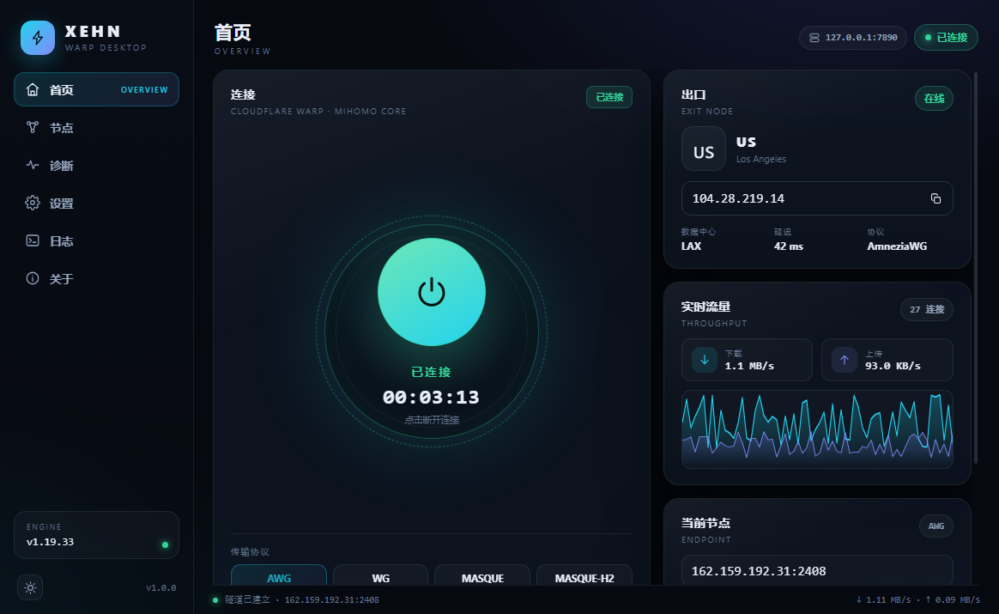
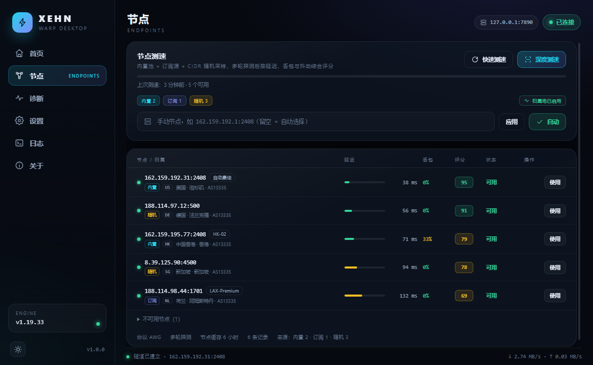
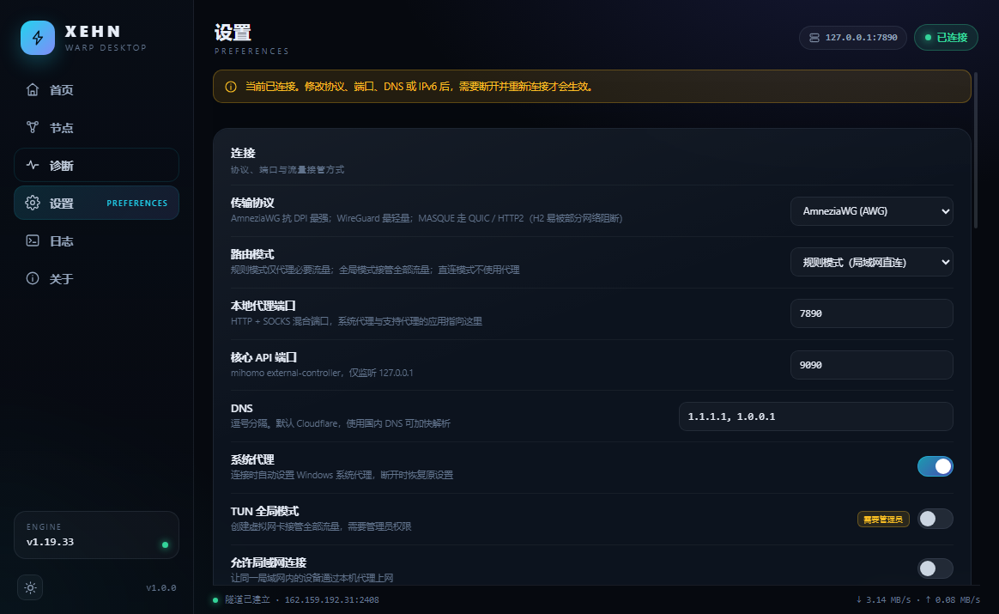
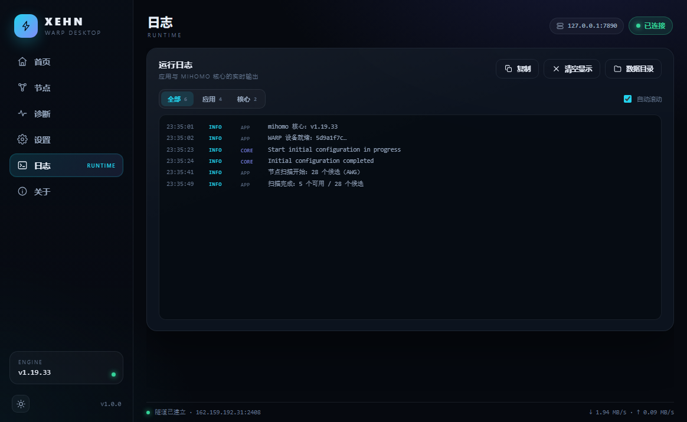
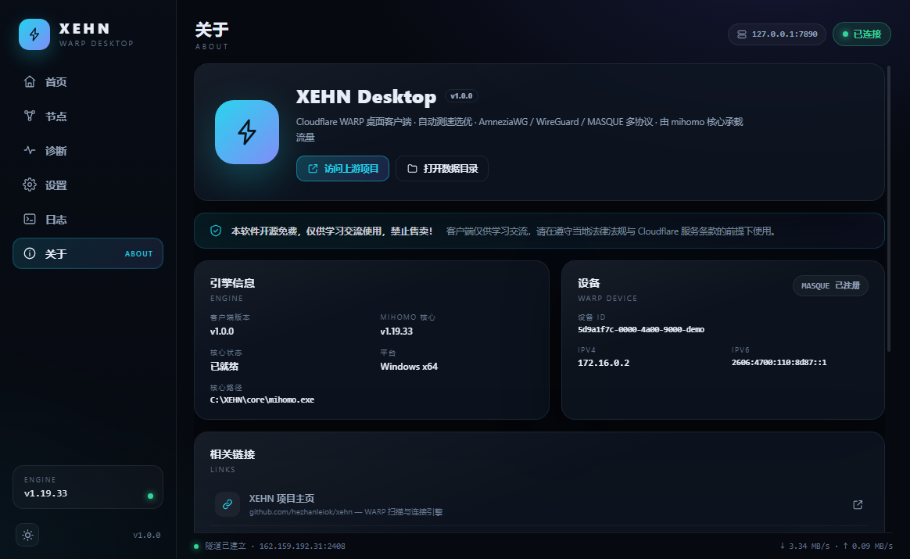
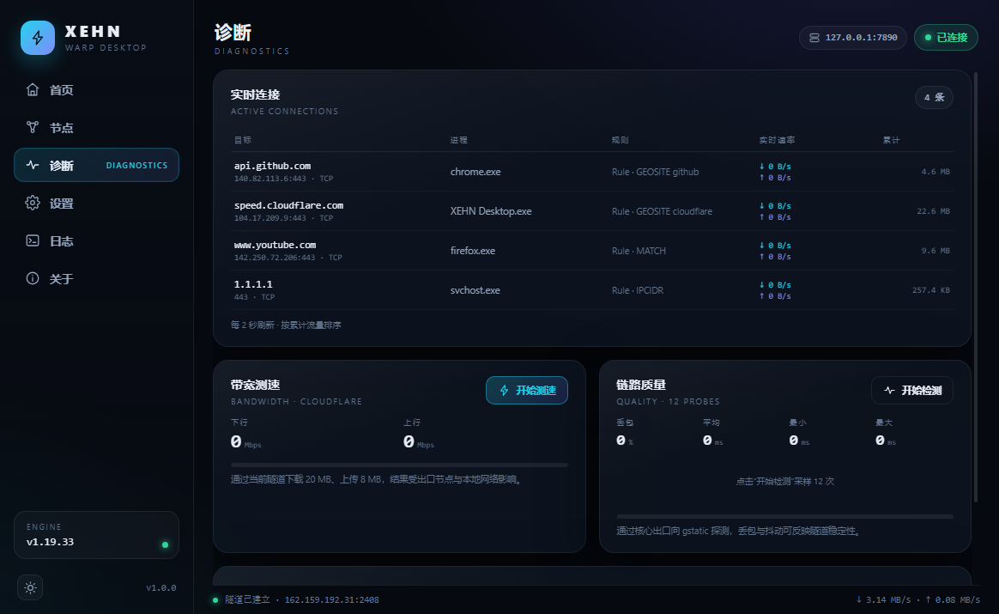
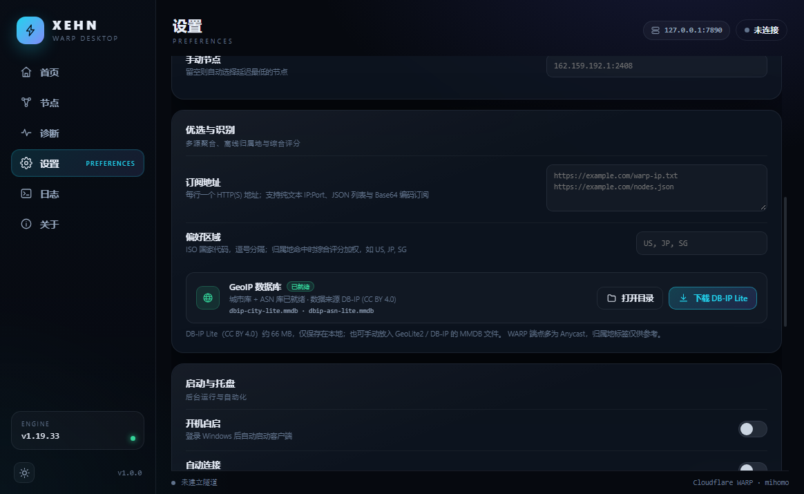

# XEHN Desktop

A Windows 10 desktop client for Cloudflare WARP, built on the ideas of
[`hezhanleiok/xehn`](https://github.com/hezhanleiok/xehn) but driving the
[mihomo](https://github.com/MetaCubeX/mihomo) core directly instead of the xehn
CLI:

- registers its own WARP device (X25519 for WireGuard/AWG, P-256 for MASQUE),
- aggregates endpoints from a builtin pool, user subscription URLs and random
  Cloudflare CIDR sampling, dedupes them, tags each with an offline GeoIP
  database and ranks them by multi-round probes,
- renders a full `config.yaml` for **AmneziaWG / WireGuard / MASQUE /
  MASQUE-H2** and supervises `mihomo.exe` as a sidecar,
- flips the Windows system proxy (WinINET) or optionally takes over with TUN,
- shows the live exit IP, colo, latency and a throughput chart,
- diagnoses a working tunnel: live connection table, bandwidth test, loss/jitter
  probing and a one-click JSON diagnostic bundle.

No account ships with the build: the first connect registers a fresh device for
that machine and stores it under the app data directory.



| Nodes | Settings | Logs | About |
|---|---|---|---|
|  |  |  |  |





## Features

| area | what it does |
|---|---|
| Connect | one click: register (first run) → scan (cached 6 h) → start mihomo → apply the system proxy |
| Protocols | AmneziaWG, WireGuard, MASQUE (HTTP/3), MASQUE-H2 — switch live from Home. MASQUE-H2 rides TCP/TLS, and some networks reset those handshakes outright while QUIC keeps working; a scan that finds no H2 node is reported, not treated as a crash |
| IP sources | builtin WARP seeds + up to 8 subscription URLs (plain `ip:port`, JSON, base64, optional `#tag`) + random sampling from Cloudflare's WARP CIDRs, merged and deduped by `ip:port` |
| GeoIP | offline MMDB lookup (DB-IP Lite city + ASN) for country, city, ASN and organisation; downloaded once from Settings (~66 MB, CC BY 4.0), no lookup traffic |
| Scan | quick (28 base WG candidates plus subscriptions) and deep (extra ports, ~86 candidates) via the core's own delay API, 8 workers, 3–4 probes per node for loss/jitter |
| Score | composite 0–100 from latency, loss and jitter, plus a bonus for preferred regions; results, source tags and geo tags are cached and shown on the Nodes page |
| Exit | live IP / country / city / colo; probes `speed.cloudflare.com/meta`, the bare-IP `1.1.1.1/cdn-cgi/trace`, ipify and `cdn-cgi/trace` in parallel and keeps the first success |
| Traffic | live up/down rates and connection count from the controller WebSocket |
| Diagnostics | live connection table (host / process / rule / per-connection rate, refreshed every 2 s), 20 MB down + 8 MB up speed test through the tunnel, 12-probe loss/jitter check, and a one-click JSON bundle (versions, settings, nodes, connections, last 400 log lines — no device keys, no `config.yaml`) |
| Routing | rule / global / direct; LAN stays direct; QUIC blocked outside CN in global mode |
| DNS | configurable resolvers, `respect-rules`; TUN mode hijacks :53 |
| Capture | system proxy (default) or TUN (admin, wintun embedded in the core) |
| Tray | close-to-tray, single instance, launch at login |
| Maintenance | one-click mihomo core download/update from GitHub releases |
| UI | dark/light themes, sidebar with Home / Nodes / Diagnostics / Settings / Logs / About |

## Requirements

- Windows 10/11 x64
- TUN mode needs an elevated process; the system-proxy mode does not.
- The packaged app bundles `mihomo.exe` (v1.19.33, `with_gvisor`). It can be
  replaced or updated from the About page.
- GeoIP is optional: scanning works without it. To enable offline lookup, use
  “下载 DB-IP Lite” in Settings (about 66 MB from `download.db-ip.com`).

## Where files live

By default everything stays in `%APPDATA%\xehn-desktop` (Electron `userData`).
Set `XEHN_DESKTOP_HOME` to pin it elsewhere.

```
<home>/
├── settings.json        user preferences
├── warp-account.json    device credentials (WireGuard + MASQUE)
├── config.yaml          the config handed to mihomo for the active session
├── nodes.json           cached scan results (6 h TTL, incl. source / score / geo)
├── session.json         last session, for recovery displays
├── proxy-backup.json    previous WinINET proxy state, restored on disconnect
├── core/mihomo.exe      core downloaded by the app (takes precedence over the bundled one)
├── geoip/               DB-IP Lite MMDBs downloaded from Settings (city + ASN)
├── diagnostics/         exported diagnostic bundles (*.json, no private keys)
├── scan/config.yaml     temporary config used while scanning
└── setproxy.ps1         helper script for the WinINET flip
```

## Build from source

```powershell
npm install
npm run typecheck
npm run dev          # electron-vite dev, hot reload
npm run smoke        # builds and captures artifacts/01-home.png … 07-optimize.png
npm run pack         # unpacked app in dist\win-unpacked
npm run dist         # XEHN-Desktop-Setup-*.exe + XEHN-Desktop-Portable-*.exe in dist\
```

The engine can be exercised without Electron:

```powershell
npm run test:engine                 # AWG only: register → scan → connect → probe exit → disconnect
npm run test:engine -- awg wg masque masque-h2
# keep the home dir for inspection:
$env:XEHN_TEST_HOME='C:\tmp\xehn-test'; npm run test:engine
# also exercise connection list, quality, speed and the diagnostic bundle:
$env:XEHN_TEST_DIAG='1'; npm run test:engine -- wg
# pull subscription URLs and prefer some countries during scoring:
$env:XEHN_TEST_SUB='https://example.com/warp.txt'; $env:XEHN_TEST_REGIONS='US, JP'; npm run test:engine -- wg
```

`test:engine` forces the system proxy off so it never touches the machine's real
settings. The test needs network access to `api.cloudflareclient.com` (register)
and to the WARP endpoints (scan/connect).

## How it works

```
electron main
├── engine/
│   ├── account.ts      WARP + MASQUE registration, rotation, JSON store
│   ├── ipSources.ts    builtin seeds, subscriptions, random CIDR sampling, dedupe
│   ├── geoip.ts        MMDB loader + DB-IP Lite download and offline lookup
│   ├── scanner.ts      multi-round core-delay probing, loss/jitter, scoring
│   ├── config.ts       mihomo YAML for connect and for scanning
│   ├── core.ts         mihomo child process + external-controller client
│   ├── coreBinary.ts   find / download / update mihomo.exe
│   ├── diagnostics.ts  connection snapshot, bandwidth + loss probing
│   ├── systemProxy.ts  WinINET apply, backup, restore, crash recovery
│   ├── probe.ts        exit-IP probing through the mixed port
│   └── engine.ts       orchestration + status/log/event stream
├── index.ts            window, tray, IPC, single instance, smoke capture
└── preload/index.ts    contextBridge API (contextIsolation on, sandbox off)
renderer
└── React 19 SPA: #/home #/nodes #/diag #/settings #/logs #/about
```

Key decisions:

- **mihomo does the protocol work.** Its `wireguard` + `amnezia-wg-option`,
  `masque` + `network: h2` and `dialer-proxy` support cover all four protocols
  without a second engine. The app only renders YAML and supervises the process.
- **Scanning is a mihomo instance too.** The client writes a config with N
  proxy entries, then asks `/proxies/{name}/delay`. No hand-rolled WireGuard
  handshake probing in JS. Each candidate is probed 3 times (4 in deep mode)
  so the scanner can report loss and jitter, not just the first delay.
- **Selection is source-agnostic.** Builtin seeds, subscriptions and random
  CIDR samples are merged and deduped before scanning. If a subscription
  carries `#tags`, they survive into the UI; failures are counted and shown
  instead of aborting the scan. Geo tagging uses a local MMDB, so the scan
  itself never calls a geolocation API.
- **DB-IP Lite instead of GeoLite2.** MaxMind's databases need an account and
  licence key; DB-IP Lite downloads straight from `download.db-ip.com`
  without credentials and is CC BY 4.0. One click in Settings fetches the
  city + ASN files (~66 MB); until then the app scans fine without geo tags.
- **Exit probe retries.** The sources are queried in parallel, one of them on a
  bare IP, so a slow DNS answer inside a cold tunnel cannot hide the exit. The
  first probe right after connect retries up to four times with 2/4/8 s
  backoff, and the 60 s heartbeat retries twice; failures log the host and the
  underlying error.
- **Crash recovery for the system proxy.** The previous WinINET state is backed
  up before the first change and restored on disconnect *and* on next start, so
  a kill/crash cannot leave the machine pointing at a dead proxy.

AWG parameters (`jc/jmin/jmax/s1/s2/h1..h4/i1`), MTU 1280, keepalive 25 and the
MASQUE SNI/`bbr`/`gvisor`/5 s handshake ceiling follow the upstream xehn
defaults. `i1` carries the same DNS-junk bytes xehn uses.

## Licence notice

本软件开源免费，仅供学习交流使用，禁止售卖！

This client is an independent reimplementation of the xehn workflow on top of
Electron. mihomo is GPL-3.0 and ships as a separate executable. Cloudflare WARP
is a service of Cloudflare, Inc.; this project is not affiliated with Cloudflare
or with the upstream xehn author.

GeoIP data is provided by [DB-IP](https://db-ip.com) under the
[CC BY 4.0](https://creativecommons.org/licenses/by/4.0/) licence and is
downloaded by the user at runtime, not bundled. WARP endpoints are usually
anycast, so a country/city tag describes the advertised route, not a guaranteed
physical location.
